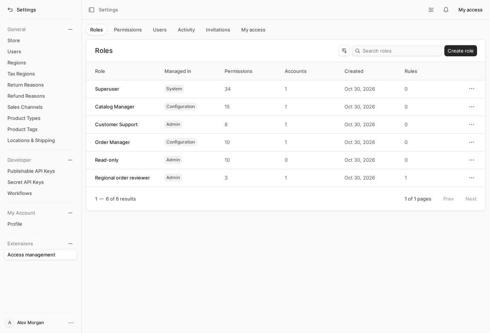
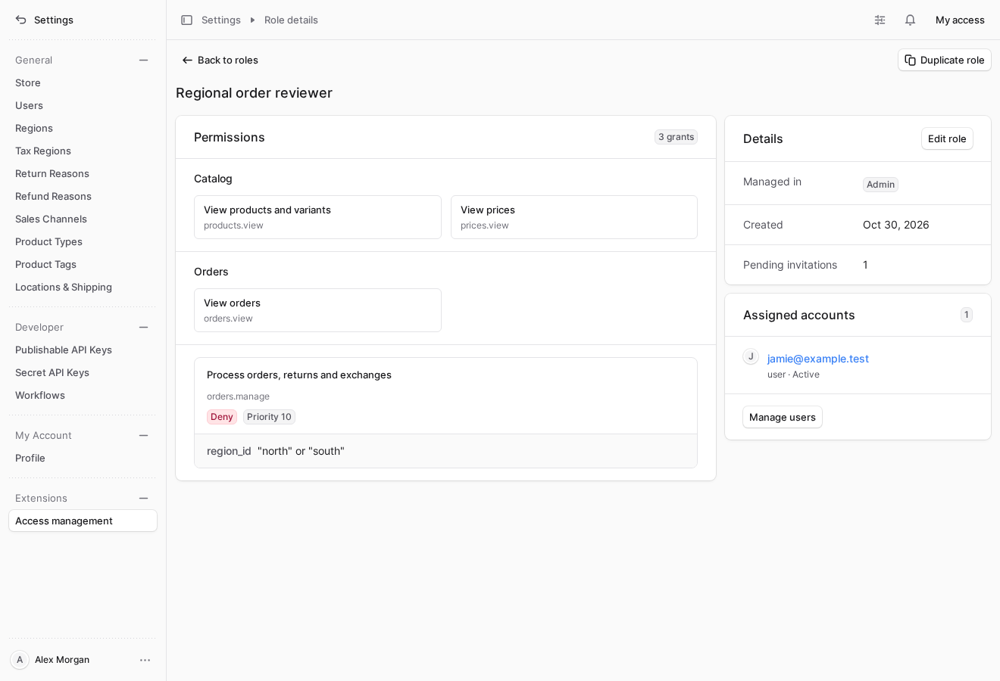
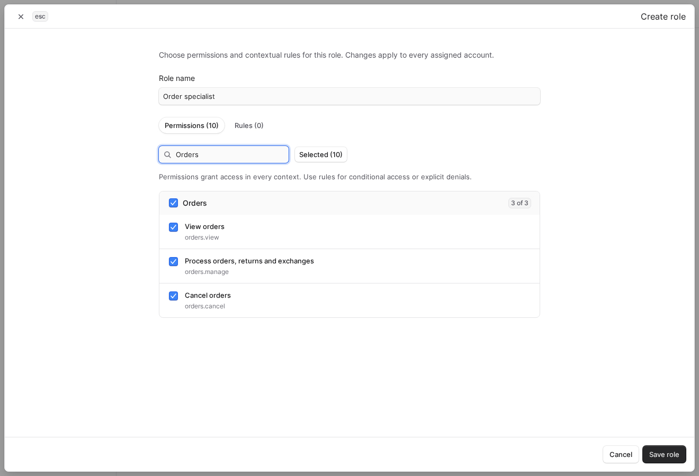
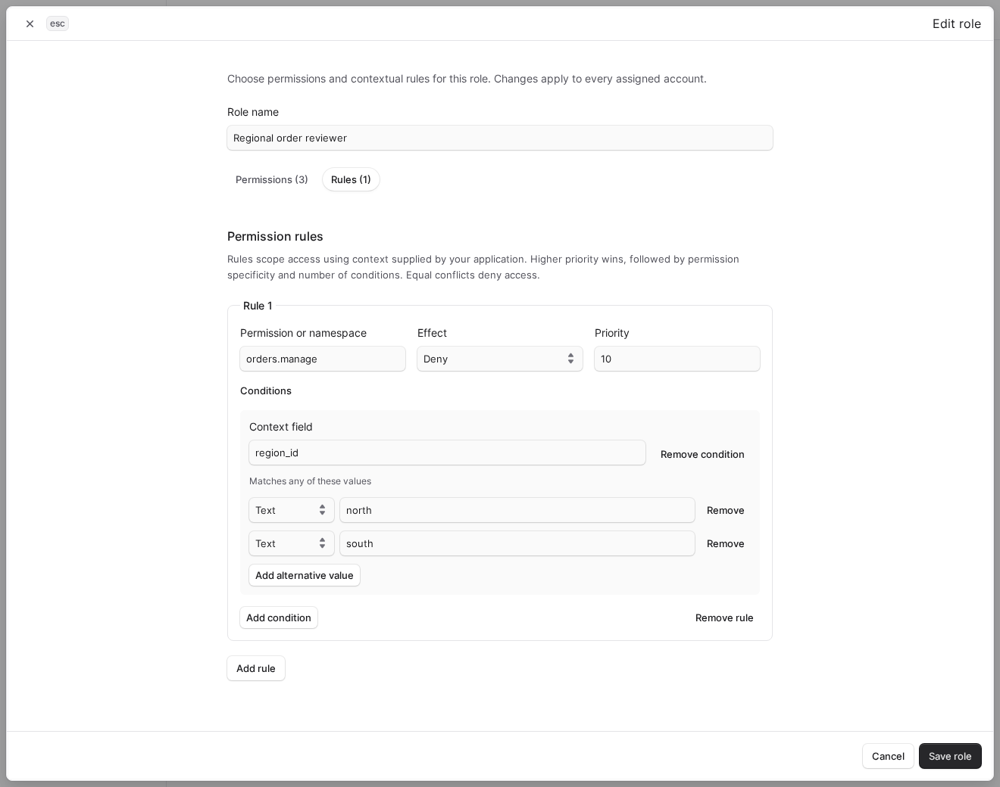
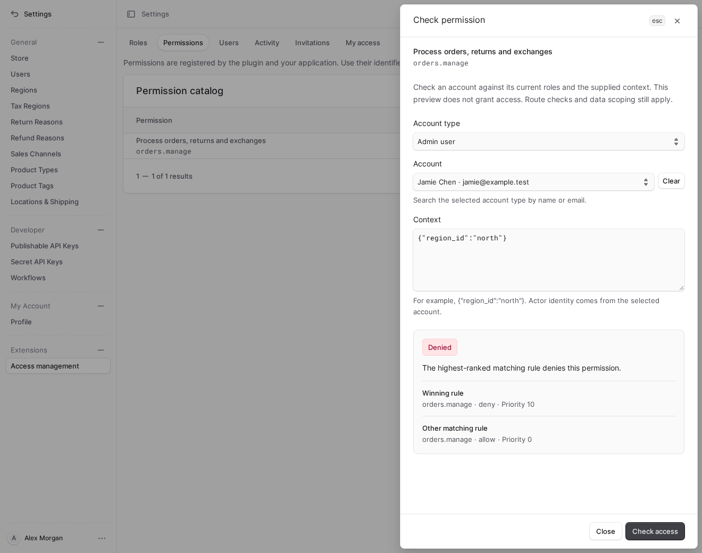
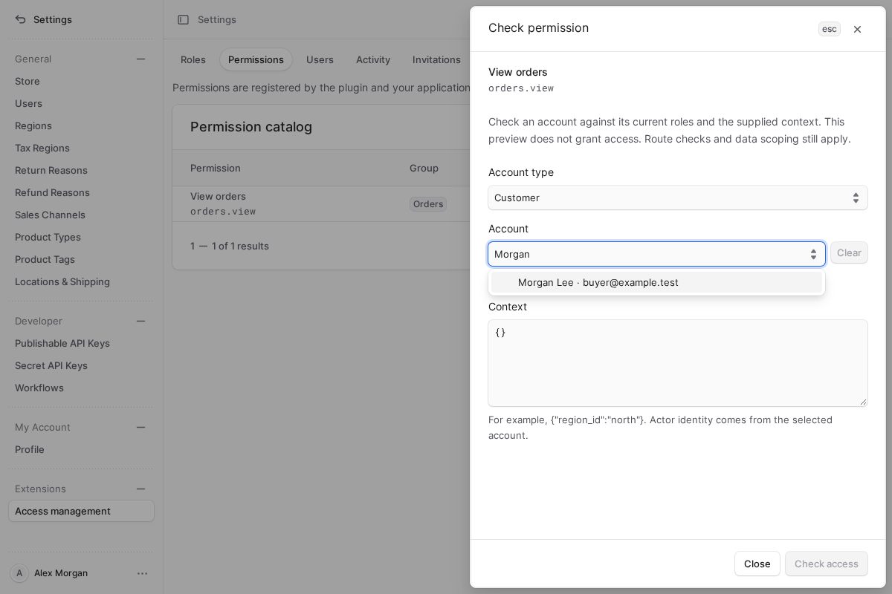
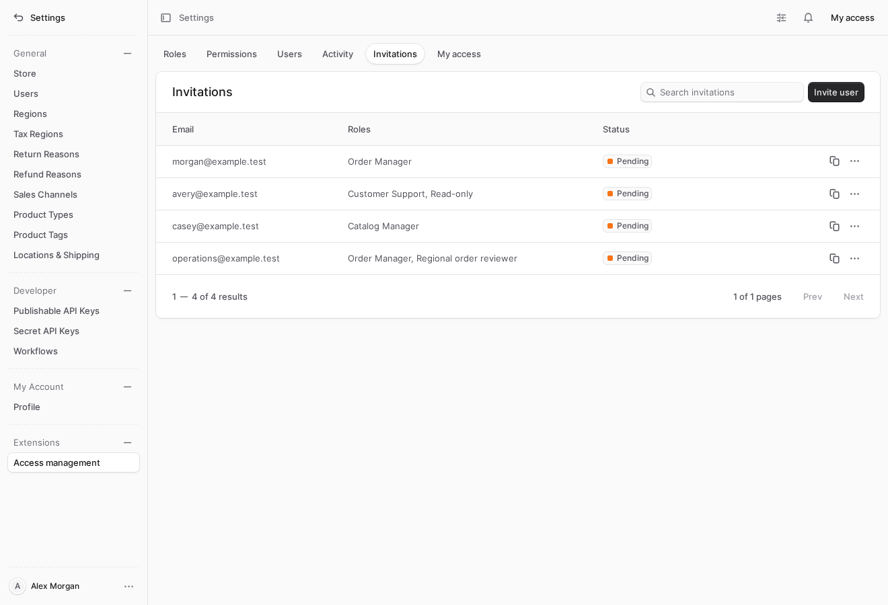
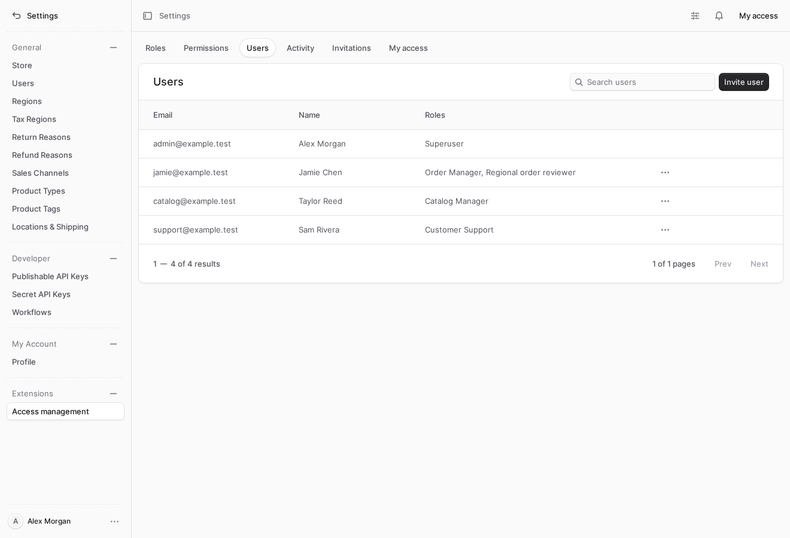
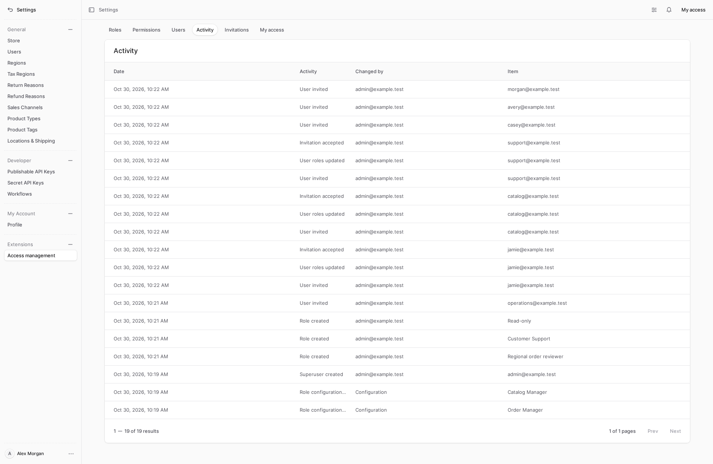

# Medusa RBAC

[](https://github.com/abhi1693/medusa-rbac/actions/workflows/ci.yml)
[](https://github.com/abhi1693/medusa-rbac/releases)
[](https://www.npmjs.com/package/@abhi1693/medusa-rbac)
[](https://docs.medusajs.com/)
[](https://nodejs.org/)
[](LICENSE)
[](https://github.com/sponsors/abhi1693)

Configurable access control for Medusa v2, with native Admin screens for roles, staff access, invitations and permission diagnostics. Define roles in application code or Admin, register permissions for your modules, and enforce access on the server for admin users, customers and custom actors.

**Superuser is the only built-in role.** Its definition is exported in code, and bootstrap creates and explicitly assigns it to a chosen native Medusa user. Applications can declare additional roles through configuration or create them in Admin/API. Configured roles never assign access automatically.

Requires Medusa **2.22.2 or newer** and Node.js **22.22.0 or newer**. Validation and the native route/field snapshots target Medusa **2.22.2**, without enabling native Enterprise RBAC.

[Install](#install) · [Admin showcase](#admin-showcase) · [Configuration](#configuration-and-extension-points) · [Storefront actors](#admin-and-storefront-actors) · [Server guarantees](#server-guarantees-and-boundaries)



## Capabilities

| Capability | What it provides |
| --- | --- |
| [Role management](#roles-and-scoped-access) | Multiple roles per account, code-managed definitions, editable Admin roles, duplication and live revocation. |
| [Permission editing](#permission-editing) | Searchable permission groups, group selection and typed contextual allow/deny rules. |
| [Access diagnostics](#check-access-before-changing-assignments) | Searchable accounts by type, context-based previews and readable decision explanations. |
| [Staff invitations](#role-bound-invitations) | Selected roles activate before first login; pending invitations can be renewed or revoked. |
| [Access activity](#access-activity) | Versioned access changes, before/after audit records and compensatable account workflows. |
| [Application extensions](#server-checks) | Public middleware, service checks, custom route policies and separate user/customer/custom-actor identities. |

## Install

Install the versioned package from npm:

```sh
npm install @abhi1693/medusa-rbac@0.0.1
```

The npm package includes built server, Admin and storefront-client exports. Published GitHub releases provide the same package as a downloadable archive, with checksums and build provenance:

```sh
npm install 'https://github.com/abhi1693/medusa-rbac/releases/download/v0.0.1/abhi1693-medusa-rbac-0.0.1.tgz'
```

To install a source revision, use Git pinned to a reviewed commit:

```sh
npm install 'git+https://github.com/abhi1693/medusa-rbac.git#<commit>'
```

The Git dependency runs `prepare` to build server and Admin extensions. npm and release archives already contain those build outputs. All methods install the package as `@abhi1693/medusa-rbac`.

For Medusa 2.22.2, review the [dependency compatibility configuration](https://github.com/abhi1693/medusa-rbac/blob/master/docs/dependency-compatibility.md). npm applies dependency overrides from your application's root `package.json`; installing this plugin does not apply the repository's overrides to your application.

If npm reports that this dependency's `prepare` script was skipped, review the pinned commit and its build script, then approve that dependency's install scripts:

```sh
npm install-scripts approve @abhi1693/medusa-rbac
npm ci
```

Commit the generated `allowScripts` policy in your application's `package.json`. Keep the approval pinned to the reviewed Git commit and update it when repinning the dependency. See [npm's install-script approvals](https://docs.npmjs.com/cli/v11/commands/npm-install-scripts/).

```ts
// medusa-config.ts
import { defineConfig } from "@medusajs/framework/utils"
import type { AccessControlOptions } from "@abhi1693/medusa-rbac/config"
import { definePermission } from "@abhi1693/medusa-rbac/define-permission"
import { defineRole } from "@abhi1693/medusa-rbac/roles"
import { defineResource } from "@abhi1693/medusa-rbac/resources"

const documentsRead = definePermission({
  id: "documents.read",
  label: "Read documents",
  group: "Documents",
})

const access: AccessControlOptions = {
  permissions: [documentsRead],
  // Optional: omit roles to keep only the built-in Superuser definition.
  roles: [
    defineRole({
      key: "document-reader",
      name: "Document reader",
      permissions: [documentsRead[0]],
    }),
  ],
  resources: [
    defineResource({
      key: "documents",
      root: "documents",
      actorTypes: ["user"],
      profile: {
        actions: { GET: "read" },
        item: {
          parameter: "id",
          profile: { actions: { GET: "read" } },
        },
      },
      operations: { read: { permissions: [documentsRead[0]] } },
    }),
  ],
}

module.exports = defineConfig({
  featureFlags: { rbac: false, rbac_filter_fields: false },
  // ...projectConfig...
  plugins: [{ resolve: "@abhi1693/medusa-rbac", options: access }],
})
```

The plugin registers its module and Admin middleware. Do not register a second instance of the module or middleware in the host.

Run `npx medusa db:migrate`. Add application CLI wrappers for administrator bootstrap and configured-role synchronization:

```ts
// src/scripts/bootstrap-superuser.ts
export { default } from "@abhi1693/medusa-rbac/bootstrap"
```

```ts
// src/scripts/sync-access-roles.ts
export { default } from "@abhi1693/medusa-rbac/sync-roles"
```

Set `RBAC_SUPERUSER_EMAIL` and run `npx medusa exec ./src/scripts/bootstrap-superuser.ts`. For a new user, supply `RBAC_SUPERUSER_PASSWORD` through a secret environment variable (at least 12 characters). Existing user credentials are preserved when no password is provided. Repeating bootstrap succeeds only for an existing active Superuser; it cannot elevate an unrelated account.

After native migrations, run `npx medusa exec ./src/scripts/sync-access-roles.ts` to apply configured roles. Include this step in your deployment's migration lifecycle before application processes start. Bootstrap also synchronizes configured roles. Neither synchronization nor configuration assigns those ordinary roles to accounts.

Open **Settings → Access management** to inspect roles and permissions, create editable roles, and assign one or more roles to users.

## Configuration and extension points

| Option | Purpose |
| --- | --- |
| `permissions` | Additional `[identifier, label, group]` definitions, including tuples returned by `definePermission({ id, label, group })`. Duplicate or invalid identifiers fail startup. Native identifiers remain registered. |
| `roles` | Optional application-owned roles declared with `defineRole({ key, name, permissions, rules })`. Definitions are synchronized explicitly and grant no automatic assignments. |
| `routes` | Explicit method/path policies for custom Admin APIs. Paths support named segments such as `:id`; `HEAD` uses the corresponding `GET` policy. Require every listed permission, or set `superuser: true`. |
| `resources` | Reusable structural profiles and capability policies for application/plugin-owned APIs. Declare collection/item actions, nested resources, commands, actor types and scope requirements once. Unknown operations remain denied. Native and access-management resources cannot be replaced. |
| `contextResolvers` | Async functions deriving rule context from trusted application data. Actor identity, method and route remain server-owned. |
| `actors` | `{ type, validate(id, request), list?(query, request) }` providers for custom actor types. Validation establishes identity; the optional paginated search adapter supplies account-picker results. Native users/customers use their owning Medusa modules. |

### Resource capabilities

Register a resource when several endpoints share the same authorization model. The public `@abhi1693/medusa-rbac/resources` entry provides `defineResource`, `crudProfile`, `commandProfile` and `actorOwnedPreferences`, together with their types.

```ts
import {
  defineResource,
  crudProfile,
  commandProfile,
} from "@abhi1693/medusa-rbac/resources"

const documents = defineResource({
  key: "documents",
  root: "documents",
  actorTypes: ["user"],
  fields: ["id", "title"],
  profile: {
    ...crudProfile(),
    children: { export: commandProfile("export") },
  },
  operations: {
    read: { permissions: ["documents.read"] },
    create: { permissions: ["documents.write"] },
    update: { permissions: ["documents.write"] },
    delete: { permissions: ["documents.write"] },
    export: { permissions: ["documents.read", "documents.export"] },
  },
})

const access = {
  permissions: [
    ["documents.read", "Read documents", "Documents"],
    ["documents.write", "Manage documents", "Documents"],
    ["documents.export", "Export documents", "Documents"],
  ],
  resources: [documents],
}
```

This profile describes collection reads/creation, item reads/updates/deletion, and the export command under `/admin/documents`. Literal commands take precedence over parameterized item routes for the requested method. It does not authorize undeclared descendants or register HTTP handlers. Compose `children` and `item` profiles for nested APIs instead of repeating URL rules. Register each custom permission through `permissions` as usual.

An operation can declare separate `personal` and `shared` permission lists through `scopes`. `actorOwnedPreferences` supplies reusable preference actions with a strict boolean shared-scope selector. The owning handler must enforce record ownership; the profile does not infer ownership from a client-supplied user ID. For existing-record scope, provide `resolveScope(request, operation)` and resolve the record through its owning module's public API. Route parameter values retain their original case. Return `null` to deny the operation.

For domain-specific changes, an action's `payload(request, operation)` callback returns additional registered permission identifiers, or `null` to deny the request. Field requirements can associate a selection pattern with additional permissions. These trusted server callbacks extend the existing evaluator without changes to its middleware. Registrations reject native-resource collisions, conflicting roots, unregistered permissions and malformed or recursive profiles at startup.

Resource registration integrates with the plugin's Admin enforcement. Other namespaces and actors continue to use explicit authentication and the public permission middleware or service checks. `resolveRequest(request)` returns the complete operation descriptor, including scope and payload requirements; `operationAllowed(principal, descriptor, allows)` evaluates it against an established principal and trusted permission context. `policyFor(method, path)` describes static requirements only and must not authorize a request that has scope or payload-dependent requirements.

## Roles defined in code

`SUPERUSER_ROLE` and `DEFAULT_ROLES` are exported from `@abhi1693/medusa-rbac/roles`. `DEFAULT_ROLES` contains only the protected Superuser descriptor; bootstrap owns its creation and assignment. Additional application roles belong in `options.roles`. `defineRole` checks the declaration's shape while preserving literal types; startup validates identifiers, names, permissions and rules.

A configured role has a stable `key`, a display `name`, and optional `permissions` and `rules`. Keep the key unchanged when renaming the role so assignments remain attached to the same record. The key `superuser` and name `Superuser` are reserved. Configured role names cannot conflict with another role.

Synchronization creates or updates configured roles in one transaction with version changes and audit events. Repeating an unchanged configuration makes no changes. Existing assignments remain in place when grants change. Removing a definition makes that role grant no access and the next synchronization persists the revocation; its assignments and pending invitation references remain available for review. Restoring the same key and synchronizing reactivates its configured grants. A key change creates a different role and revokes the removed definition's grants.

Configured roles are marked as managed in application configuration. Their names, permissions and rules cannot be edited or deleted through Admin or the management API. **Duplicate role** creates an independent, editable Admin role; it does not copy account assignments. Superuser remains protected separately. Use the service's public `syncConfiguredRoles()` method when integrating synchronization into an existing application workflow.

## Server checks

A custom API outside `/admin` can use the exported middleware after Medusa authentication:

```ts
import { authenticate, defineMiddlewares } from "@medusajs/framework/http"
import { requirePermission } from "@abhi1693/medusa-rbac/require-permission"

export default defineMiddlewares({
  routes: [
    {
      matcher: "/documents/:id",
      method: "GET",
      middlewares: [
        authenticate("user", ["session", "bearer"]),
        requirePermission("documents.read"),
      ],
    },
  ],
})
```

`requirePermission(...identifiers)` requires every listed permission; `requireAnyPermission(...identifiers)`, exported from the same entry point, requires at least one. Both run after native authentication and resolve the actor and trusted context through the configured service.

Use the module's `allows(principal, permission, context)` for application workflow/service checks. HTTP middleware does not automatically authorize jobs, scripts or workflows invoked outside HTTP; those callers must establish an actor and check permissions themselves.

The module token is `ACCESS_CONTROL` from `@abhi1693/medusa-rbac/modules/access-control`; its service type is exported from `@abhi1693/medusa-rbac/service`. Admin SDK helpers are exported from `@abhi1693/medusa-rbac/admin/access`. The framework-independent storefront client is exported from `@abhi1693/medusa-rbac/client`. Both reuse Medusa authentication.

## Admin and storefront actors

Assignments are keyed by both `actor_type` and `actor_id`. Admin users and storefront customers share the permission engine while retaining separate identity and access records. Custom actor types can register an identity validator backed by their owning module.

Admin APIs require a native `user` identity. The protected Superuser role can only be assigned to admin users. Customer credentials cannot gain Admin access through role assignments, and an identifier reused across actor types does not share grants.

Use `GET` or `POST /admin/access/actors/:actor_type/:id` to inspect or update an actor's assignments as a Superuser. Writes require `role_ids`, `active` and the current `version`. Validate storefront routes with Medusa authentication before checking a registered storefront permission:

```ts
middlewares: [
  authenticate("customer", ["session", "bearer"]),
  requirePermission("store.documents.read"),
]
```

The module exposes `actorPrincipal({ type, id })`, `actorAccess({ type, id })` and the `set_actor` mutation for backend workflows. Native commerce Store APIs retain their normal behavior unless an application explicitly adds permission enforcement.

### Custom account search

The permission checker's account picker loads Admin users and customers through Medusa's User and Customer services. Custom actor providers can add `list(query, request)` alongside their required `validate(id, request)` function. The public `ActorProvider`, `ActorListQuery`, `ActorListResult` and `ActorOption` types are exported from `@abhi1693/medusa-rbac/actors`.

The search adapter receives:

| Field | Meaning |
| --- | --- |
| `q?` | The user's search text. Match suitable labels, names or email fields in your owning module. |
| `id?` | An exact account ID used to restore a selected record that is outside the current search page. Return that record alone, or an empty result if absent. |
| `offset` | The number of matching records to skip. |
| `limit` | The maximum number of records to return, between 1 and 100. |

Return `{ actors, count }`, where each actor has `{ id, label, description? }` and `count` is the total number of matching records before pagination. Restrict results to the provider's actor type, preserve stable ordering across pages and honor exact-ID queries. Resolve the owning service through the supplied request; do not search another module's tables directly. The API adds `offset` and `limit` to the response for the native paginated picker.

`GET /admin/access/actors/:actor_type` accepts these query fields and requires an active native-user Superuser. It returns display records for selection, without exposing role assignments or authentication data. A custom provider without `list` can still validate identities for server checks; its account search reports that it is unavailable. The picker requires selection from search results. The evaluation endpoint independently calls `validate` before checking permissions.

## Permission rules

An ordinary role has explicit `permissions` and optional `rules`. For example:

```json
{
  "name": "Regional order reader",
  "permissions": [],
  "rules": [
    {
      "permission": "orders.view",
      "effect": "allow",
      "priority": 10,
      "conditions": { "region_id": ["north", "south"] }
    }
  ]
}
```

Keys support exact identifiers, namespace suffix wildcards (`orders.*`) and `*`. A wildcard must match a registered permission. Conditions use scalar equality or membership in an array; missing context never matches. All conditions must match. There is no query-derived ownership assumption, arbitrary expression execution or automatic database row filtering. Configure a trusted resolver and scope the underlying query when granting access to a collection.

Matching rules from all assigned roles are evaluated together: higher priority, then exact key or more specific namespace, then more conditions, then deny on a tie. Explicit permission grants behave like an exact allow at priority zero. Superuser has all registered permissions, including later additions. Inactive accounts always deny. A broad grant can defeat a narrower wildcard deny through specificity; use explicit deny priorities when required.

The role editor groups permissions by area, supports search, group selection and a selected-only filter, and provides typed condition controls for text, numbers, booleans, empty values and alternatives. Personal access includes application-defined permission labels and read-only rule details. Its permission list describes explicit role grants; contextual access is decided per request.

## Server guarantees and boundaries

- Every Admin operation requires a native user identity. Customer and secret API-key principals cannot inherit staff access.
- Native commerce operations use a reviewed Medusa route/field inventory. Unknown methods/routes, arbitrary workflow execution, API-key management and native RBAC endpoints deny, including for Superuser. Extension policies cannot reopen native or access-management routes.
- Active staff can manage their personal native Admin layouts. Shared layout changes require `settings.manage`; native actor ownership and bounded field selection remain enforced.
- Role, invitation and staff administration require an active Superuser. Ordinary roles cannot delegate this authority. The system role and its name are protected, self-deletion is rejected, and transactional locking preserves at least one active Superuser.
- Role/staff writes require record versions. Assignments, access mutations and before/after audit events commit atomically. Access is read on every request; Admin refreshes its access state while visible.
- Managed invitations compose native workflows and activate assigned roles before first login. Pending invitations reserve their roles. Account deletion and invitation failures use compensation.
- Audit history records access changes. It is not a log of every authorization decision or a complete commerce audit system.

## Administration and invitations

The plugin uses supported Admin routes and widget zones with Medusa UI tables, drawers and focus modals. It requires no modifications to Medusa packages. **Settings → Access management** includes Roles, Permissions, Users, Invitations, Activity and My access. Each role has a shareable detail page with readable permission groups, scoped rules, its management source, assigned-account counts, paginated account assignments and pending invitation counts. The native user-detail page includes an editable Roles widget. Superusers can manage profiles, password resets and account deletion through Medusa's Users screen. Deleting an account from either Users screen applies the same safeguards: self-deletion and deleting the last active Superuser are rejected.

Create an invitation in the Invitations tab, select its roles and share the generated private link. Links honor the application's Admin base path and open the acceptance form through the supported login widget. Acceptance uses native EmailPass registration, associates the identity with the new user and activates the selected roles before first login. A failed acceptance restores the invitation and identity association so the same credentials can retry. The workflow composes public user-creation, invite-deletion and grouped-event steps; events publish after successful completion.

Native invitation events remain available for an application notification subscriber. To deliver role-bound invitations by email, configure that subscriber to use the plugin’s login URL: `<admin-origin>/<admin-path>/login?rbac_invite=<token>`. Link creation itself does not require an email provider. Native invitation acceptance and deletion preserve managed role assignments and the same safeguards. Create invitations in the plugin's Invitations tab when selecting roles during signup.

The native Admin keeps its navigation, account menu and error handling. The topbar **My access** link remains available when an operation is denied. Permission changes refresh access and revalidate native routes without requiring another login. Access management authorizes every read and write on the server.

The plugin works independently of Admin Kit. A host may separately install [medusa-admin-kit](https://github.com/zanreal-labs/medusa-admin-kit) for its shared Catalog table and cross-plugin column registry.

## Account management APIs

Account deletion and managed invitations use these canonical endpoints:

| Operation | Endpoint |
| --- | --- |
| Delete a user | `DELETE /admin/access/staff/:id` |
| Delete a managed invitation | `DELETE /admin/access/invites/:id` |
| Accept a managed invitation | `POST /access/invites/accept?token=<token>` |

User and invitation deletion require an active native-user Superuser. Invitation acceptance requires a valid invitation token and an unregistered native user authentication identity. The canonical endpoints run compensatable workflows that coordinate native User/Auth operations with access assignments and auditing. User deletion returns `{ id, object: "user", deleted: true }`; invitation deletion returns `{ id, object: "invite", deleted: true }`.

Public middleware delegates native user deletion and managed invitation deletion/acceptance to these endpoints using HTTP 307. The redirect preserves the method and body, and each destination independently authenticates and validates the operation. Native Medusa handlers remain unchanged. Updates to another user's profile and password-reset token generation use native endpoints with Superuser authorization. Users retain restricted editing of their own profile.

The Medusa 2.22.2 SDK follows these redirects using its normal session or bearer authentication. Redirect destinations are fixed paths on the same backend origin. Expose backend APIs at the origin root; the Admin UI may use its configured base path. API clients that disable redirect following should call the canonical endpoints directly. A redirect response itself performs no account mutation.

## Permission diagnostics

The **Permissions** view lists registered identifiers, labels and groups. A Superuser can choose **Check access**, choose an account type, then search and select an existing account by name or email. The results are limited to the selected actor type and load additional pages as needed. Changing the type clears the previous account and result. After selecting an account, supply a context to inspect the current decision. The preview validates the actor through its owning module and uses the same permission engine as enforcement. It returns the outcome, reason, winning match and other matching rules. Actor identity comes from the selected account.

This is a permission preview: it does not grant access, invoke a route, run context resolvers for a hypothetical resource, or verify collection filtering. Route policies, trusted request context and application data scoping still apply to a real request. Access Activity records administrative changes, including configured-role synchronization; it does not store every permission decision.

Backend code can inspect a registered permission with the pure helper:

```ts
import { explainPermission } from "@abhi1693/medusa-rbac/explain"

const decision = explainPermission(principal, "documents.read", trustedContext)
// decision.allowed, decision.reason, decision.matches
```

Provide an established principal, a registered permission and trusted context. Use the service's `allows` method or middleware for enforcement. `POST /admin/access/evaluate` exposes the Admin preview and requires an active native-user Superuser.

## Admin showcase

The plugin uses Medusa UI components and supported Admin routes and widget zones. These screens work with the application's configured Medusa backend and authentication.

### Roles and scoped access

Open a role's detail page to inspect its grants, contextual rules, management source, assigned accounts and pending invitations. Stable links make the same role easy to revisit and share within the Admin.



### Permission editing

Search permissions, select a group or focus on the selected set. Typed rule controls support contextual conditions and explicit allow/deny priorities.



<details>
<summary>Explore the contextual rule editor</summary>

Set a permission, effect, priority and typed conditions to express access for a particular request context.



</details>

### Check access before changing assignments

Choose an account, supply context and inspect its current permission decision. The preview uses the enforcement engine and leaves assignments unchanged.



Account search stays within the selected account type. Native users and customers use their owning Medusa modules; custom actor providers can supply their own search adapter.



### Role-bound invitations

Select roles when inviting a staff member and activate them as part of account acceptance. Review pending access, renew a link or revoke an invitation from the same screen.



<details>
<summary>Assign roles to an existing staff account</summary>

Review staff accounts and their combined roles in the Users view. Open a user to manage assignments through the native user-detail Roles widget.



</details>

### Access activity

Review who changed access, the affected role or account, and when it happened. Configuration synchronization and administrative changes use the same access audit history.



## Storefront client

Use your application's configured Medusa SDK, including its backend URL, publishable key and customer authentication:

```ts
import { createAccessClient } from "@abhi1693/medusa-rbac/client"

const access = createAccessClient(sdk)
const summary = await access.me("customer")
// summary.actor, summary.roles, summary.permission_candidates
```

`GET /access/actors/:actor_type/me` requires native session or bearer authentication for the requested actor type and validates the actor through its owning module. It returns only that actor's role names and candidate permission identifiers, without exposing policy conditions or another account's assignments. Candidates are navigation hints: context-dependent permissions still require server authorization for each operation. The client has no React or browser-global dependency and accepts optional request headers for server rendering.

## Development

```sh
npm ci
npm run typecheck
npm run format:check
npm test
npm pack --ignore-scripts --dry-run
```

The tests cover native route inventories, middleware denial, configurable permission/role registries, role synchronization and removal, typed actor isolation, rule precedence/context and explanations, concurrency guards, workflow compensation and Admin components. Run `RBAC_TEST_DATABASE_URL=<local-postgres-url> npm run test:integration` for isolated PostgreSQL actor and invitation rollback/retry checks. Browser lifecycle checks also run in the consuming application’s isolated test harness. `npm run access:snapshot` refreshes the native inventory for a reviewed framework upgrade; generating a snapshot never authorizes new routes.

Release preparation, npm publication and package verification are documented in [Preparing and publishing a release](docs/releasing.md).

Framework references: [plugins](https://docs.medusajs.com/learn/fundamentals/plugins/create), [module options](https://docs.medusajs.com/learn/fundamentals/modules/options), [API middlewares](https://docs.medusajs.com/learn/fundamentals/api-routes/middlewares), [Admin widgets](https://docs.medusajs.com/learn/fundamentals/admin/widgets).

## License

[MIT](LICENSE)
